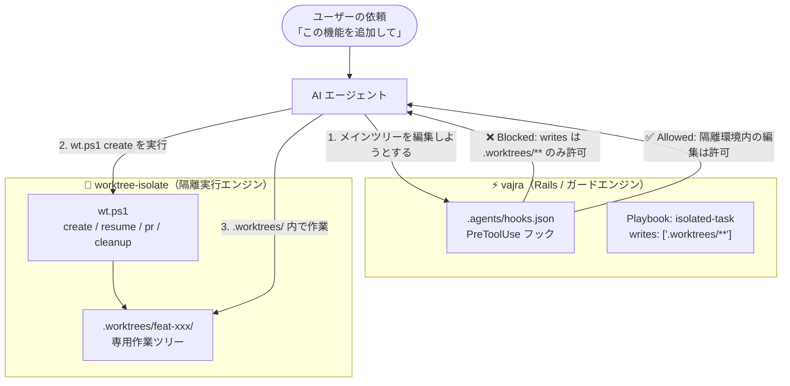

# vajra × worktree-isolate 連携ガイド

**「お願い（散文ルール）」から「絶対に曲がらないレール（Rails）」へ。**

`vajra` のワークフロー管理・ライフサイクルフックと `worktree-isolate` を組み合わせることで、**AI エージェントがメインブランチを誤って直接編集することを物理的に遮断（PreToolUse deny）し、git worktree による安全な隔離作業を強制** できます。

---

## 連携の仕組み



1. **メインツリー直接編集のブロック**:
   - Playbook の `writes: [".worktrees/**"]` 定義により、AI がメインツリーのファイルを `edit_file` / `write_file` しようとすると、vajra の `PreToolUse` フックが即座に拒絶（`{ decision: "deny" }`）します。
2. **安全な隔離環境への誘導**:
   - 拒絶されたエージェントは、`worktree-isolate` の `wt.ps1 create` を呼び出して専用の Worktree を作成し、その中で安全に作業を進めます。
3. **不可逆コマンドの防止**:
   - `guards: ["git push origin main", "git merge"]` により、メインブランチへの直接 push や不正なマージをフックで未然に防ぎます。

---

## 導入手順

### 1. スキルの準備（目指す状態）

Antigravity で **`vajra`**（または vajra で生成したワークフロー）と **`worktree-isolate`** の両方がスキル（スラッシュコマンドなど）として呼び出せる状態を作ります。
運用の都合に合わせて **「プロジェクトローカル配置（推奨）」** または **「グローバル配置」** のいずれかを選択できます。

---

#### 選択肢 A: プロジェクトローカル配置（推奨・自己完結型）
プロジェクト直下の `.agents/skills/` にスキルを配置して Git にコミットします。  
チームメンバーや CI、別 PC で clone した場合でも、**事前の環境設定なしで即座に Rails と worktree 隔離が有効** になります。

- **`worktree-isolate` の配置**:  
  本リポジトリの `skills/worktree-isolate` を、対象プロジェクトの `.agents/skills/worktree-isolate` にコピーします。
- **vajra ワークフローの配置**:  
  対象プロジェクト内で `/vajra` を実行してワークフローを生成するか、生成済みのワークフロースキルを `.agents/skills/<your-flow>/` に配置します。

---

#### 選択肢 B: グローバル配置（PC全体での共用型）
自分のマシン上のあらゆるリポジトリで使い回したい場合は、グローバルスキル領域（`~/.gemini/config/skills/`）に配置します。

- **`worktree-isolate` の配置**:
  ```powershell
  cd /path/to/worktree-isolate
  .\scripts\deploy.ps1
  ```
- **`vajra` の配置**:
  ```bash
  # 公式 CLI でグローバルインストールする場合
  npx skills add zwire/vajra -g

  # または、ローカルリポジトリからスキルフォルダを配置する場合
  Copy-Item -Recurse -Force "/path/to/vajra/skills/vajra" "$HOME\.gemini\config\skills\vajra"
  ```

> [!TIP]
> Antigravity のチャット入力欄で `/` をタイプし、ワークフロースキル（または `/vajra`）および `/worktree-isolate` が候補に表示されれば準備完了です。

---

### 2. プロジェクトへの Playbook の配置
対象プロジェクトの vajra ワークフローディレクトリ（例: `.agents/skills/your-flow/playbooks/`）に、本ディレクトリの Playbook を配置します：
- `isolated-task.md`: 隔離作業用プレイブック
- `cleanup-task.md`: マージ後クリーンアップ用プレイブック

### 3. フックのインストール
対象プロジェクトのルートで以下を実行し、Antigravity フック（`.agents/hooks.json`）を生成します：

```bash
node <your-flow>/scripts/flow.mjs install --harness antigravity
```

これで、対象プロジェクトにおけるエージェントの作業環境が自動的にレールで保護されます。
